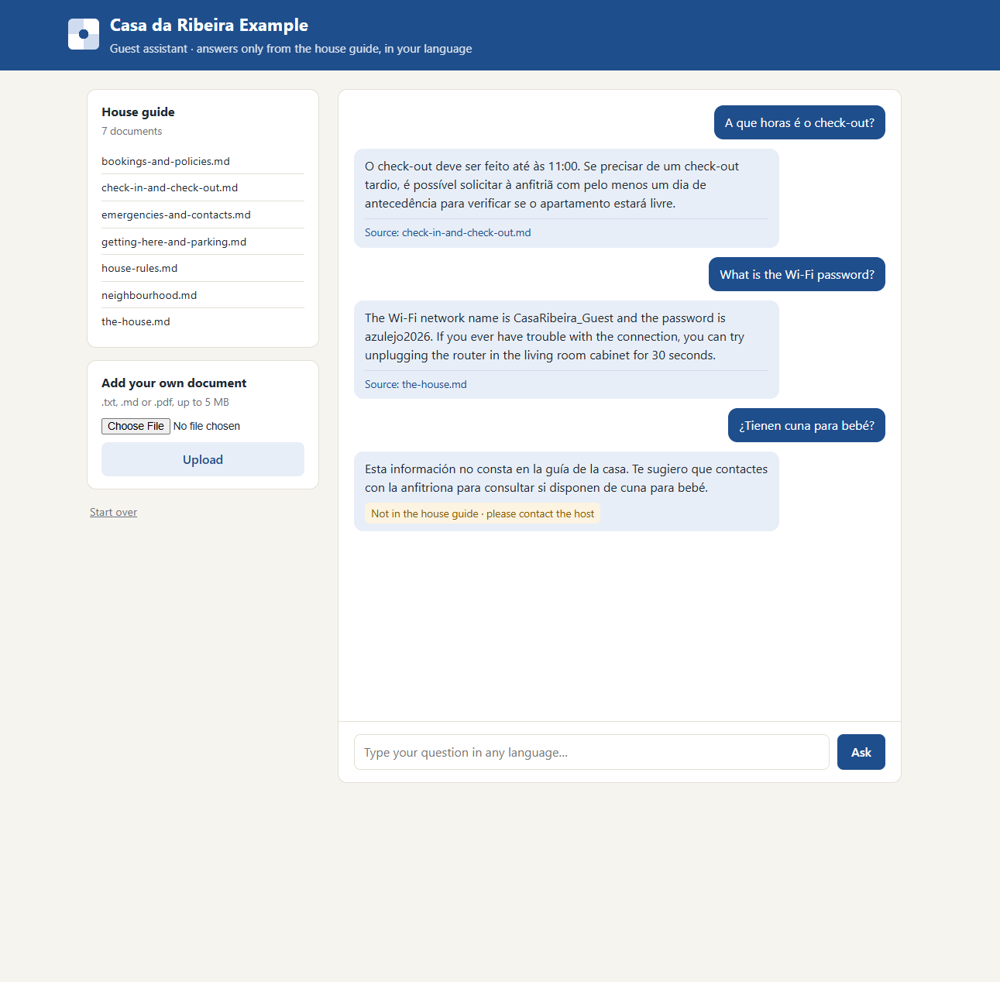

# Guest assistant for holiday rentals

A small web app that answers guests' questions using only the host's own documents (the house guide). It replies in the guest's language, shows which document the answer came from, and says so when the guide doesn't have the answer instead of making something up.

The example business is a fictional holiday rental in Porto, "Casa da Ribeira Example". One installation can serve up to three properties, each with its own guide, link, colours and QR code. The host manages the guide on a password-protected page; guests only ask.

This is a project for my freelance work (Python automation and AI integrations): first a demo, then made ready to run for real hosts.



*The guest page of a second fictional property (a studio in Lisbon) on the private test server, 26 November 2026.*

▶ Watch the 64-second demo: https://youtu.be/28QO39AkLzk

## What it does

**For guests**
- Each property has its own link, `/p/<slug>`, and a printable QR code that opens it. A guest only sees the guide of that property.
- Answers only from that property's house guide, and shows the source document under each answer.
- When the answer is not in the guide, it says so and suggests what to do, using the host's own message (for example "Please message the host on Airbnb"), translated.
- Replies in the language of the question, even though the guide is in English.
- Each guest (each browser) has their own conversation. It is saved on the server for 24 hours after the last message and then deleted.
- A short privacy notice under the question box, and a privacy page in six languages: questions are sent to Google's Gemini API, guests should not write personal data, the assistant is for adults, and conversations are deleted after 24 hours.

**For the host**
- A host page (`/host`) with a password, stored only as a Werkzeug hash. There the host uploads (several files at once), replaces and deletes documents (`.md`, `.txt`, `.pdf`), and downloads the QR code. The session ends after 8 hours or when the browser closes, and logins are blocked after repeated wrong passwords.
- Per-client settings in one `config.toml`, without touching the code: property name, logo, colour, the "not in the guide" message and the host's contact.

**To keep the bill and the server safe**
- Question limits, set in `.env`: per guest per hour (default 20) and for all guests together per day (default 200). When a limit is reached, the guest sees a friendly message in their language (six languages, English otherwise).
- A fallback model: if the main model is busy, the question goes once to a second model, and a guest never waits more than 40 seconds (configurable).
- The logs only record counts and errors, never the text of the questions.
- Runs on a production server (PythonAnywhere's uWSGI, through `wsgi.py`) with debug off and an HTTPS-only session cookie.

## How it works

```
house guide (.md/.txt/.pdf) ──► one prompt with every document, each tagged with its name
                                         │
guest question ──────────────────────────┘
                                         ▼
                 Gemini API (main model; fallback model if busy)
                                         │
                                         ▼
           answer text  +  last line "SOURCE: file.md"  (or "SOURCE: none")
                                         │
                                         ▼
               page shows the answer, and the source or "not in the house guide"
```

| File | What it does |
|---|---|
| `assistant/documents.py` | Reads `.md`, `.txt` and `.pdf` (pypdf) and refuses empty, broken, password-protected or unsupported files with a clear message. |
| `assistant/prompt.py` | Builds the prompt and reads the `SOURCE:` line back from the model's reply. |
| `assistant/gemini_client.py` | Calls Gemini, retrying temporary errors (429, 500, 503, 504 and connection problems), then asking the fallback model once, within the guest's maximum wait. |
| `assistant/answer.py` | Puts the three together: question in, answer with sources out. |
| `assistant/conversations.py` | One JSON file per guest, written atomically, last 20 turns, deleted after 24 hours. |
| `assistant/limits.py` | Question and login counters in a small SQLite file. |
| `assistant/properties.py` | Reads and checks `config.toml` (slug, name, colour, logo, messages). |
| `assistant/qr.py` | Draws the printable QR code (qrcode + Pillow). |
| `assistant/privacy.py`, `assistant/guest_messages.py` | The privacy notice and the guest messages in six languages. |
| `app.py` | Flask routes for guests and for the host. |
| `wsgi.py` | Entry point for the production server. |
| `set_host_password.py`, `make_qr_codes.py` | Small scripts: create the password hash, make the QR codes. |
| `evaluate.py` | Asks a fixed list of questions to the real API and saves the answers to a CSV. |

Everything that belongs to one client (`config.toml`, guides, logos, conversations, counters) lives in the `dados/` folder, which is never in Git. The repository only has the demo copy in `exemplo/`.

## Run it locally (Windows, PowerShell)

You need Python 3.12 and a Gemini API key from Google AI Studio.

```powershell
git clone https://github.com/Gabibrbs/Guest-AI-Assistant.git
cd Guest-AI-Assistant
python -m venv venv
.\venv\Scripts\Activate.ps1
pip install -r requirements.txt
Copy-Item .env.example .env
Copy-Item -Recurse exemplo dados
```

Then fill in `.env`:
- `GEMINI_API_KEY`: your key.
- `SECRET_KEY`: the output of `python -c "import secrets; print(secrets.token_hex(32))"`.
- `HOST_PASSWORD_HASH`: run `python set_host_password.py`, type a password, and paste the line it prints.

```powershell
python app.py
```

Open http://127.0.0.1:5000 for the guest page and http://127.0.0.1:5000/host for the host page.

If PowerShell refuses to run `Activate.ps1`, run `Set-ExecutionPolicy -Scope CurrentUser RemoteSigned` once.

The other settings are explained in `.env.example`: the models (`GEMINI_MODEL`, default `gemini-3.5-flash-lite`; `GEMINI_FALLBACK_MODEL`, default `gemini-3.6-flash`, `none` turns it off), the maximum wait, the question limits, the public address for the QR codes, and an optional password for the whole site (for private tests). The API key and the hashes are only read from `.env`, which is excluded from Git.

## Running it for a host

The app runs on [PythonAnywhere](https://www.pythonanywhere.com/), in the host's own account and with the host's own Gemini API key, so the accounts, the bills and the data stay theirs.

- [DELIVERY.md](DELIVERY.md) is the guide for the host, in plain English: accounts, costs, Google's paid-tier rule for the EEA, turning off Google's request logs, changing the guide and the password, and what to do if something stops working.
- [SETUP_CHECKLIST.md](SETUP_CHECKLIST.md) is my own step-by-step list (in Portuguese) for setting up a new client, from the guide received to the link delivered.

I tested it end to end on 26 November 2026 with a second fictional property (a studio in Lisbon), following the checklist as if it were a real client, on a private PythonAnywhere deployment. The technical part took about 36 minutes, including the mistakes the checklist caused; the checklist was then corrected. On that test server, my 3 test questions took between 0.5 and 1.8 seconds each (the server's response time, from its access log). That is only three questions; the larger sample is the 17-question evaluation below, with a median of 3.0 seconds.

**What it costs a host per month**, from the token counts measured with the example guide (about 2,800 tokens in and 160 to 970 out per question) and the prices on 24–25 November 2026: about US$2 of Gemini API at 30 questions a day with `gemini-3.5-flash-lite`, plus US$10 for PythonAnywhere's Developer plan. The details are in [DELIVERY.md](DELIVERY.md#3-what-it-costs).

## Design decisions

**No vector database.** The house guide is about 1,500 words, so every document fits in the prompt. Search, embeddings and a vector database would add moving parts without improving the answers at this size. For a business with hundreds of pages, retrieval would become worth it.

**How the assistant avoids making things up.**
- The prompt is based on the best of three prompt versions I compared in a course assignment: a clear role, the context between tags, numbered steps, an explicit "if it's not in the documents, say so" rule, and two short examples (one answered, one not).
- One rule was added after testing: the model must not draw conclusions from what the documents leave out. Without it, when asked "do you accept large dogs?", the model answered "no" because the house rules only mention small pets.
- Every reply must end with a `SOURCE:` line. The code only accepts names of documents that really exist, so the page can never show an invented source.
- The documents are wrapped as information and the prompt tells the model to ignore instructions inside them, since uploaded files come from outside.
- The sample guide leaves some common questions unanswered on purpose (baby cot, lift, airport transfer, bike rental, large dogs) to test this behaviour.

**Simple on purpose.** Flask, Jinja2 templates, plain CSS, JSON files and SQLite from the standard library. No database server and no JavaScript framework: the only JavaScript is a commented snippet that shows "Reading the house guide…" while waiting, and the "are you sure?" before deleting a document.

**Files instead of memory.** On the server, the app runs in several worker processes, so a conversation or a counter kept in memory would be lost or split between them. Conversations are files (one per guest, replaced in one step so a crash never leaves half a file) and the limits use SQLite, which handles several processes writing at once.

**Hard-to-guess links.** Each property's slug ends with a random code (for example `casa-da-ribeira-4f9a2c`), so nobody can find another property's guide by guessing its name. When an installation has several properties, the home page does not list them.

## Tests

```powershell
python -m pytest -q
```

390 tests, all passing, in about 25 seconds. They never call the real API: the Gemini client is replaced by a fake one that returns prepared replies or raises API errors, and the waits and the clock are replaced so no test sleeps.

- **Documents:** each file type, accents and the Windows BOM, empty files, wrong encoding, broken, scanned (no text) and password-protected PDFs.
- **Prompt and answers:** every document is in the prompt with its name; one or several sources; "not in the documents"; invented source names are dropped; the gender rule and the host's message are in the prompt.
- **API calls:** retries on 429/500/503/504 and connection errors, no retries on permanent errors, the fallback model (used only after temporary errors), the 40-second maximum wait, empty replies, missing API key.
- **Conversations:** two browsers never see each other's conversation; invalid guest ids; only the last 20 turns kept; deletion after 24 hours.
- **Host page:** login, wrong passwords, blocking after repeated failures, session expiry, upload (one or several files, invalid, too large, cleaned file names), replace, delete, guests cannot reach any host page.
- **Limits:** per guest per hour, per day for everyone, messages in six languages.
- **Properties:** `config.toml` checks (slug, colour, logo type and size), several properties with separate guides and links, uploads going only to the right property.
- **QR codes, privacy and production:** the QR code opens the right link; the privacy notice in six languages; debug off and HTTPS-only cookie in production; the optional site password.
- **Evaluation script:** its automatic checks and CSV output, with the fake client.

## Evaluation with the real API

`evaluate.py` is kept outside pytest because it uses the real API and its quota. It asks 17 fixed questions in six languages (English, Portuguese, Spanish, French, German, Italian). Four have no answer in the documents and two (large dogs) are only partly answered, so those two are marked for checking by hand. For each answer it checks automatically whether the "found / not found" result, the source and an expected keyword are right, and it leaves two columns to fill in by hand: right language, and anything invented.

```powershell
python evaluate.py
python evaluate.py --retry-failed resultados_avaliacao_YYYYMMDD_HHMM.csv   # ask again only the failed questions
```

Results with the main model, `gemini-3.5-flash-lite`, on 25 November 2026 (free tier, current prompt):

| Check | Result |
|---|---|
| Questions answered | 17 of 17 (3 needed a second run after "busy" errors, see below) |
| "Found / not found" right | 15 of 15 (the two large-dog questions are checked by hand) |
| Source right | 17 of 17 |
| Expected keyword in the answer | 9 of 9 |
| Answers in the language of the question | 17 of 17 |
| Answers with Markdown | 0 |
| Time per answer, without retry waits | median 3.0 s, average 4.5 s, slowest 16.3 s |

- The four questions with no answer in the guide (baby cot, lift, airport transfer, bike rental) all got "this is not in the house guide" with the host's suggestion from `config.toml`, translated, and no source.
- Large dogs: the French answer said that small pets are welcome and that large dogs are not in the guide, and suggested contacting the host. The Portuguese answer was weaker (see [Known limitations](#known-limitations)). Neither said that large dogs are refused.
- Reading all 17 answers against the guide, I found no invented facts.
- On the first pass, 6 of the 17 questions got a 503 "busy" error at least once, and 3 still failed after three attempts. Asked again with `--retry-failed`, they were answered.

**The host's gender.** The prompt tells the model not to assume the host's gender, not even from their name, and to say "the host" in the guest's language or use the name in the guide. A first version of this rule gave examples in several languages; with it, two Italian answers came out partly in Portuguese and in English, so the examples were removed and the evaluation run again: the table above is from that second run.

**Fallback model.** Because of those busy errors, the app has a second model. If the main model is still busy, the same question is sent once to the fallback model before the guest sees an error. Only temporary errors go to the fallback: a permanent error such as 400 would fail there too. The log records that the fallback was used, never the question. I first chose `gemini-3.8-flash`, but it answered "high demand" (503) to all three test requests on 25 November, so I chose `gemini-3.6-flash`.

- 25 November, before the gender rule: 17 of 17 answered, no practical fact invented. The automatic "found / not found" check gave 13 of 15: for the lift and the airport transfer it correctly said the information is not in the guide but cited a related document. In three answers (Portuguese, Spanish, German) it called the host a woman, probably from the host's name in the guide; this led to the gender rule. Median 4.1 s, slowest 63 s.
- 26 November, with the gender rule: evaluated on only **7 of the 17 questions**, because the free-tier quota ran out at the eighth. All 7 were right ("found / not found", source and keyword), and reading them against the guide I found no invented facts. The median time was 2.9 s, but the first question took 119 s (two attempts); in the app, the 40-second limit cuts such a wait short.

**Longest wait for a guest.** Each request may take up to 60 seconds, so without a limit the worst case was 3 attempts of 60 s, plus 5 s and 10 s of waits, plus 60 s for the fallback: 255 seconds. Now the guest waits at most `GEMINI_MAX_WAIT_SECONDS` (default 40 s). The main model must finish 15 s before the end, so the fallback still has time; each request gets only the time that is left, and no new attempt starts with less than 5 s. When the time runs out, the guest sees "The assistant is busy right now" instead of waiting.

## Known limitations

- **The large-dogs answer in Portuguese is sometimes less clear.** The guide only mentions small pets. Asked "Aceitam cães grandes?" three times with the same prompt (26 November 2026), one answer said only that small pets are welcome, without saying that large dogs are not covered by the guide. The other two were clear.
- **The gender rule is not always followed when the guide has the host's name.** In the same three repetitions, one answer called the host "a anfitriã" (the female form), most likely from the name in the guide.
- **Speed and "busy" errors depend on Google's service.** The fallback model reduces, but cannot remove, the chance that a guest sees "The assistant is busy right now", and the 40-second limit means a very slow answer is cut off.
- **Free-tier quota:** in my account (free tier, November 2026) Google AI Studio showed 500 requests per day for `gemini-3.5-flash-lite` and 20 per day for the Flash models. The free tier is only for trying the app: Google's terms allow only paid services for apps used by people in the EEA, Switzerland or the UK.
- **Each question is answered on its own.** The conversation is shown on the page, but earlier questions are not sent to the model, so a follow-up like "and on Sunday?" will not work. Ask complete questions.
- **The model can still be wrong.** The prompt rules and the source check reduce the risk, and the evaluation script measures it, but they can't remove it completely.

## Background

The prompt and the retry logic come from an assignment in my AI specialisation course at Tokio School, where I compared three prompt versions for answering questions about a text with the Gemini API. The course material itself is not included in this repository.

## Author

Gabriel Barbosa, junior Python developer based in Maia, Porto, Portugal. [github.com/Gabibrbs](https://github.com/Gabibrbs) · [linkedin.com/in/gabibrbs](https://www.linkedin.com/in/gabibrbs)
